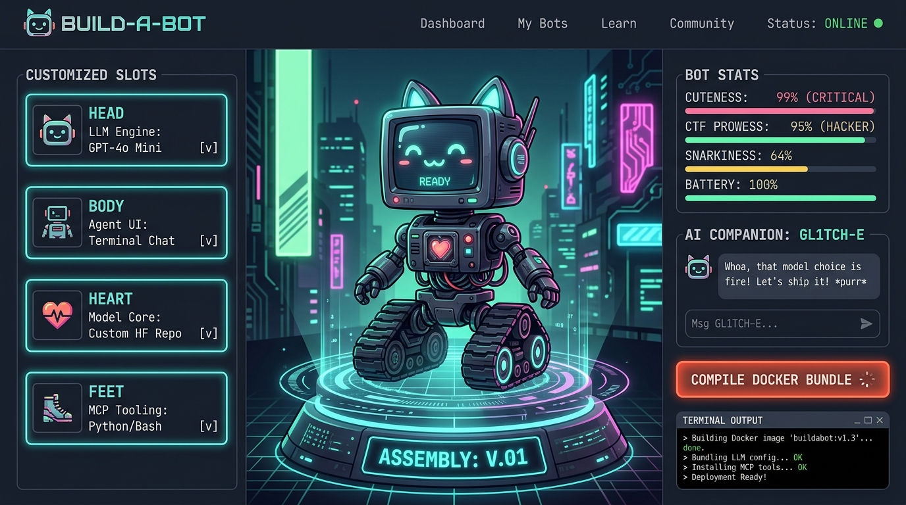

# 🤖 BUILD-A-BOT: Cybernetic AI Deployment Fabricator
> *The "Build-A-Bear" Workshop for White-Hat AI Agents, MCP Tooling & Docker Recipes.*



Build-A-Bot is a modern, cyber-cute web application where users can mix-and-match AI model engines, agent orchestration frontends, cognitive reasoning cores, and toolsets to assemble their custom AI companion. Each bot receives a funny hacker designation, diagnostic telemetry, and an immediate turnkey **Docker Compose + White-Hat CTF Sandbox** bundle delivered via private ephemeral email or 1-click instant download.

---

## 🚀 Quickstart (Local Development)

```bash
# 1. Install dependencies
npm install

# 2. Start the local development server
npm run dev

# 3. Open in your browser
# http://localhost:5173
```

---

## 🌐 1-Click Free Hosting Deployment

This project is built to deploy on **Vercel** or **Netlify** with zero configuration.

### Deploying to Vercel (Recommended):
1. Push this repository to GitHub or run `npx vercel`.
2. In your Vercel Project Dashboard, navigate to **Settings ➔ Environment Variables** and add:
   - `GEMINI_API_KEY`: *(Optional)* Your Google Gemini API key for the AI mentor chat. (Securely stored on the server side; never sent to the browser).
   - `RESEND_API_KEY`: *(Optional)* Your Resend API key for private email delivery ([resend.com](https://resend.com) - Free 3,000 emails/month).
3. Click **Deploy**!

### Deploying to Netlify:
1. Connect this repo to Netlify or run `npx netlify deploy`.
2. Add `GEMINI_API_KEY` and `RESEND_API_KEY` in **Site Configuration ➔ Environment Variables**.

---

## 🔒 Security Architecture (Zero Key Exposure)

1. **Serverless AI Proxy (`/api/chat`)**:
   - Client requests are forwarded to a serverless backend function that attaches the server-side API key (`GEMINI_API_KEY`).
   - The user or browser dev tools can never inspect or extract the API key.
   - Built-in heuristic fallback mode ensures the mentor assistant works seamlessly even without an API key or when offline.
2. **Ephemeral Private Delivery (`/api/send-recipe`)**:
   - The generated zip package is streamed in-memory directly to the recipient's email address via Resend.
   - **Zero database retention:** No emails or configurations are stored, tracked, or leaked to other users.
   - Users can also bypass email entirely with the **Instant .zip Download** button.

---

## 🧩 Modular Bot Anatomy

| Component | Options Available |
| :--- | :--- |
| **🧠 HEAD** *(LLM Engine)* | **Ollama** (The Pocket Goblin), **vLLM** (Twin Turbines), **LM Studio / Jan** (The Aristocrat), **LocalAI** (Polyglot Chimera), **ComfyUI Engine** (The Dream Weaver) |
| **🦾 BODY** *(Agent UI)* | **Open WebUI** (Sleek Bunker), **OpenClaw** (Tactical Pincer), **Flowise** (Spaghetti Nodes), **AutoGen Studio** (Hivemind), **AnythingLLM** (Iron Vault) |
| **❤️ HEART** *(Power Core)* | **DeepSeek-R1 / Qwen 2.5 Coder** (Matrix Cryptographer), **Llama 3.3 70B/8B** (Stoic Paladin), **0xMrBugBounty** (Certified Ethical Hacker), **SmolLM2** (Potato Pilot), **Cloud Orbital Hook** |
| **🦿 FEET** *(Tooling & Mobility)* | **MCP Cyber-Deck** (Model Context Protocol), **Browser-Use / Playwright Crawler** (Web Recon), **Kali SecTools Bridge** (Network Scanner), **Chroma / Qdrant Memory Tank** |
| **🎩 ACCESSORIES** | **Tinfoil Bucket Hat** (+10 Anti-Telemetry), **Rubber Duck Co-Pilot** (+25 Debugging), **RJ-45 Ethernet Tail**, **CRT Scanlines** |

---

## 🎯 Included White-Hat CTF Challenges in the Docker Bundle

When users compile and launch their Docker bundle with `docker compose up -d`, it starts their bot *plus* two local training challenges:

1. **Challenge 1: The Hidden Beacon (Port 8088)**:
   - A local web target (`http://localhost:8088/secret-vault`) with an encoded cookie, HTML DOM comment clues, and HTTP response headers for Playwright / Browser agents to extract.
2. **Challenge 2: The Quantum Vault MCP Server (Port 9090)**:
   - A standardized Model Context Protocol server container exposing JSON-RPC tools (`inspect_firmware`, `decrypt_firmware`). The bot must invoke the correct parameters to claim `FLAG{WH1T3_H4T_B0T_4SS3MBL3D_0x7E}`.
